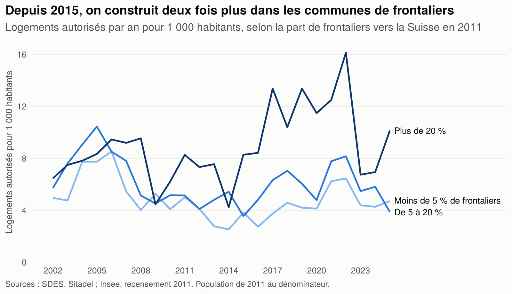
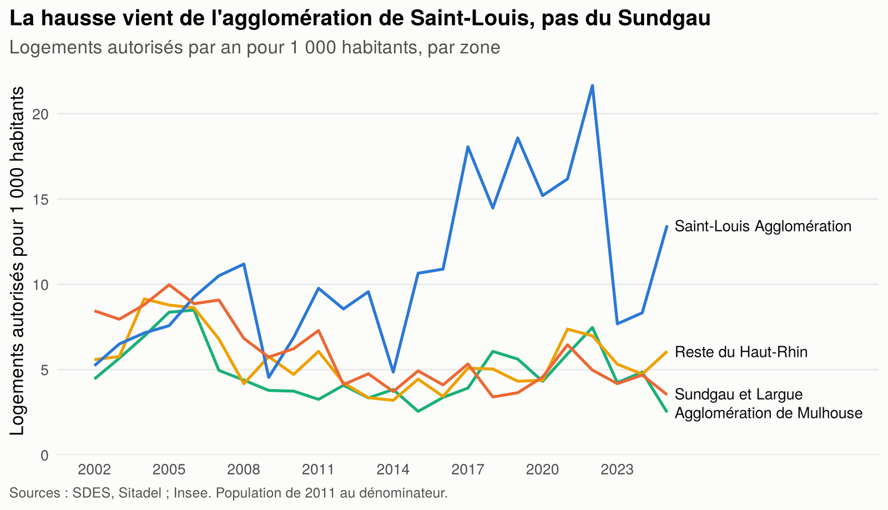

# Frontaliers et construction de logements dans le Haut-Rhin

Je pensais montrer une chose, et j'en ai trouvé une autre.

L'idée de départ est simple. Dans le Haut-Rhin, près de 42 000 personnes travaillent en Suisse et sont payées en francs. Depuis 2007, le franc a gagné 75 % face à l'euro. Leur pouvoir d'achat en France a donc beaucoup augmenté, et je m'attendais à ce que l'on construise davantage dans les communes où ils habitent.

Au premier regard, c'est bien ce que montrent les permis de construire.

J'ai ensuite cherché ce qui pouvait faire tomber ce résultat, et je l'ai trouvé. Il suffit de retirer les 40 communes de l'agglomération de Saint-Louis pour que l'effet disparaisse. Dans le Sundgau, où un actif sur quatre travaille pourtant en Suisse, on construit deux fois moins qu'il y a vingt ans.

Avoir beaucoup de frontaliers ne suffit donc pas pour qu'une commune construise. Saint-Louis, aux portes de Bâle, bâtit des immeubles et gagne des habitants. Le Sundgau, un peu plus loin, construit surtout des maisons, et de moins en moins.

La note de quatre pages présente la démarche et les résultats : [Note_Frontaliers_Construction_Haut-Rhin.pdf](note/Note_Frontaliers_Construction_Haut-Rhin.pdf).

## Ce que l'étude ne dit pas

Je ne sais pas quelle part de la hausse à Saint-Louis vient du franc. Elle démarre en 2015, l'année où le franc bondit, mais d'autres choses ont pu changer au même moment dans l'agglomération : les transports, les règles d'urbanisme, les terrains disponibles. Mes données ne permettent pas de les séparer.

Deux autres réserves :

- Je compte des logements autorisés, pas des logements construits. Un permis peut être abandonné.
- Les frontaliers viennent du recensement, qui est un sondage. Dans les petites communes, les effectifs sont des ordres de grandeur.

## Les données

Tout est public.

| Donnée | Source | Période |
|---|---|---|
| Logements autorisés par commune | SDES, Sitadel | 2002 à 2025 |
| Actifs travaillant en Suisse ou en Allemagne, par commune de résidence | Insee, recensement | 2011, 2018, 2022 |
| Population par commune | Insee | 2006 à 2023 |
| Taux de change euro / franc suisse | Banque centrale européenne | 2002 à 2025 |
| Loyers d'annonce par commune | Carte des loyers, ANIL | 2025 |

J'aurais préféré travailler sur les prix de vente. Ils n'existent pas en accès libre pour l'Alsace : les ventes y sont inscrites au livre foncier et ne figurent pas dans le fichier national DVF. C'est pour cette raison que l'étude repose sur les permis de construire.

Le fichier national des permis fait 4,3 millions de lignes et 170 Mo. Il est trop lourd pour être déposé ici, comme les fichiers du recensement. Les liens de téléchargement sont dans [`data_raw/LISEZ-MOI.md`](data_raw/LISEZ-MOI.md). La base finale, elle, est dans le dépôt : [`base/base_communes_annees_68.csv`](base/base_communes_annees_68.csv), une ligne par commune et par année (366 communes, 24 années).

## La méthode en deux mots

Je compare l'évolution de la construction entre les communes, selon la part de leurs actifs qui travaillaient en Suisse en 2011. Cette part est fixée avant la forte hausse du franc, pour qu'elle n'en soit pas une conséquence.

Le modèle est une régression de Poisson sur le nombre de logements autorisés, avec un effet fixe par commune et un effet fixe par année. Les écarts-types sont regroupés par commune.

Le résultat de départ passe ensuite sept tests : deux autres seuils de frontaliers, les frontaliers vers l'Allemagne, les maisons seules, les immeubles seuls, la comparaison à l'intérieur de chaque intercommunalité, et l'estimation sans Saint-Louis. Ce sont les deux derniers qui le font tomber. Le détail est dans [`base/resultats_tests.csv`](base/resultats_tests.csv).

## Refaire les calculs

Il faut R, avec les paquets `DBI`, `RSQLite`, `readxl`, `ggplot2` et `fixest`.

1. Télécharger les fichiers bruts listés dans `data_raw/LISEZ-MOI.md` et les placer dans `data_raw/`.
2. Ouvrir le dossier comme projet RStudio.
3. Lancer les scripts dans l'ordre.

| Script | Ce qu'il fait |
|---|---|
| `scripts/01_preparer_donnees.R` | Charge les fichiers bruts dans une base SQLite et exécute les requêtes du dossier `sql/` pour construire la base communes × années |
| `scripts/02_decrire.R` | Figures 1 à 3 et premier tableau |
| `scripts/03_estimer.R` | Régressions, tests, figures 4 et 5 |
| `scripts/04_comparer_zones.R` | Tableau qui compare Saint-Louis, le Sundgau, Mulhouse et le reste du département |

Pour aller plus vite, on peut partir directement de la base finale et lancer les scripts 02 et 03. Le script 04 a aussi besoin des deux fichiers de loyers.

## Contact

Guillaume Bousson, diplômé du master Statistique et économétrie de l'Université de Strasbourg.
Une question ou une erreur repérée : les *issues* du dépôt sont ouvertes.
